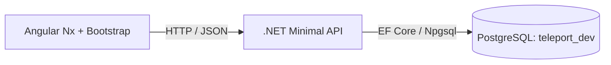
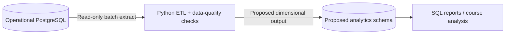

# Teleport Analytics Architecture v0

**Status:** Week 8 design proposal. No separate analytics warehouse has been deployed.

## Current Operational Architecture

The existing PostgreSQL database is the operational system of record. The app and API use normalized tables for destinations, activities, trips, itinerary items, and expenses.

## Proposed Analytical Data Flow

The local Week 6 pipeline currently transforms reviewed raw CSV research into cleaned CSV files and loads destinations/activities into PostgreSQL. The diagram's OLTP-to-analytics batch is a proposed next step, not a completed or scheduled service.

## OLTP vs. OLAP

| Aspect | OLTP: operational data | OLAP: analytical data |
| --- | --- | --- |
| Purpose | Support application actions such as reading destinations and creating trips. | Summarize data for questions such as activity coverage or recorded spending. |
| Shape | Normalized relational tables with primary and foreign keys. | Read-oriented fact and dimension structures or aggregate views. |
| Workload | Small, frequent application reads and writes. | Grouping, filtering, joins, and aggregate queries across a set of records. |
| Teleport example | `destinations`, `activities`, `trips`, `itinerary_items`, `expenses`. | Proposed expense fact joined to trip and date dimensions. |

## Proposed Fact/Dimension Grain

A minimal expense analytical model could use:

- **FactExpense:** one row per recorded expense; measures are `amount` and an implicit row count.
- **DimTrip:** one row per trip with trip name and date range.
- **DimDate:** one row per calendar date with year, month, and day attributes.

The fact would link to trip and expense date. The current expense table has no destination foreign key, so spending must not be attributed to a destination unless a future requirement adds that relationship. Currency is also unspecified, so amounts cannot be safely combined across currencies if mixed currencies are later allowed.

## Small Analytical Demonstration

`database/analysis/week-7-queries.sql` and `database/analysis/week-8-reporting-demo.sql` provide read-only analysis and reporting examples. `database/schema/003_reporting.sql` defines two views and two functions over the operational schema. The November 4, 2026 verification returned 2 destination rows, with 3 activities for Lisbon and 2 for Porto; the functions returned the same activity counts.

The current database still has 0 trips, 0 itinerary items, and 0 expenses. The trip-expense view and trip-based query therefore return no rows, and the expense-total function returns `NULL`. These are empty-state results, not measured zero spending. No spending conclusion is supported yet.

## Implementation Boundary

The proposed dimensional output is not implemented. First collect reviewed trip and expense records through the actual application; then decide whether a separate schema/table or a reporting view is appropriate. No Azure/AWS analytics or storage resources are created by this design document.
