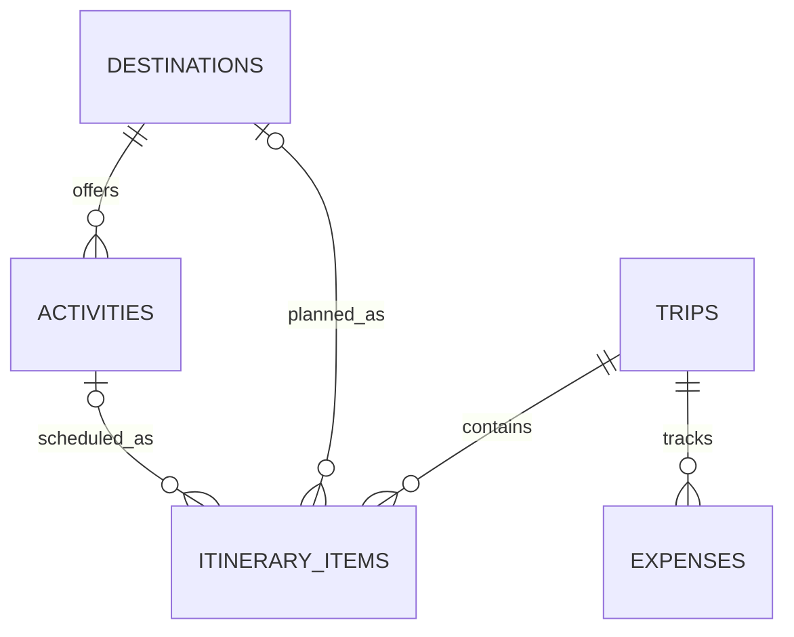

# Teleport Data Model and API Plan v0

**Status: Implemented and locally verified.** The SQL schema and EF Core mapping are applied to local PostgreSQL. The API smoke test verified destination listing/search/activity reads and trip, itinerary, and expense CRUD/validation against the database. It does not cover every individual detail route; see `scripts/smoke-test-api.sh` for exact coverage.

## Scope Assumptions to Confirm

- **Confirmed:** The first database prototype has no sign-in or account ownership because registration and authentication are not in the current core user stories.
- Trip start and end dates are optional; when both exist, the end date cannot precede the start date.
- Expense currency is not yet specified. This model stores a positive numeric amount only; it does not convert currencies.
- Destination and activity records are a small sourced demonstration set, loaded by `database/seed/002_demo_data.sql`; the ETL workflow uses an isolated target database.

## Proposed Relational Model

| Table | Proposed fields | Purpose |
| --- | --- | --- |
| `destinations` | `id` PK, `name`, `region`, `category`, `description`, `image_url` | Browse, search, filter, and display destination details. |
| `activities` | `id` PK, `destination_id` FK, `name`, `description` | Store activities associated with a destination. |
| `trips` | `id` PK, `name`, `start_date`, `end_date` | Create and review a basic trip. Dates and validation rules need review. |
| `itinerary_items` | `id` PK, `trip_id` FK, nullable `destination_id` FK, nullable `activity_id` FK, `sort_order` | Organize destinations or activities within a trip. A check constraint should require exactly one of destination/activity per item. |
| `expenses` | `id` PK, `trip_id` FK, `description`, `amount` | Record basic expenses for a trip. Amount must be positive. Currency is undecided. |

This draft has five related tables. It intentionally does not add users, categories, or other entities without a supporting requirement.

## Data-Access Choice

EF Core with the Npgsql provider was selected for this relational CRUD prototype. EF Core maps the five related entities and can manage schema migrations; direct Npgsql SQL would keep each query explicit but require manual query and row mapping. No performance comparison has been run, so this is a provisional learning-oriented choice rather than a measured result.

## Initial API Resource Plan

The API is the only application layer that accesses PostgreSQL. The table records the routes implemented and the exact breadth of local smoke-test coverage; detail routes not exercised by the script remain unverified.

| Method and route | Purpose | Status |
| --- | --- | --- |
| `GET /api/destinations` | Browse, search, and filter destinations. | Smoke-tested with PostgreSQL. |
| `GET /api/destinations/{id}` | View destination details. | Browser-tested; not covered by the API smoke script. |
| `GET /api/destinations/{id}/activities` | View activities for a destination. | Smoke-tested with PostgreSQL. |
| `GET /api/trips` | List trips. | Smoke-tested with PostgreSQL. |
| `POST /api/trips` | Create a trip. | Smoke-tested with PostgreSQL. |
| `GET /api/trips/{id}` | View basic trip details. | Smoke-tested with PostgreSQL. |
| `PUT /api/trips/{id}` | Update a trip. | Smoke-tested with PostgreSQL. |
| `DELETE /api/trips/{id}` | Delete a trip. | Smoke-tested with PostgreSQL. |
| `GET /api/trips/{tripId}/itinerary-items` | List a trip's itinerary. | Smoke-tested with PostgreSQL. |
| `POST /api/trips/{tripId}/itinerary-items` | Add a destination or activity to a trip. | Smoke-tested with PostgreSQL. |
| `PUT /api/trips/{tripId}/itinerary-items/{id}` | Change itinerary order. | Smoke-tested with PostgreSQL. |
| `DELETE /api/trips/{tripId}/itinerary-items/{id}` | Remove an itinerary item. | Smoke-tested with PostgreSQL. |
| `GET /api/trips/{tripId}/expenses` | List expenses for a trip. | Smoke-tested with PostgreSQL. |
| `GET /api/trips/{tripId}/expenses/{id}` | View one trip expense. | Implemented; not directly smoke-tested. |
| `POST /api/trips/{tripId}/expenses` | Add an expense to a trip. | Smoke-tested with PostgreSQL. |
| `PUT /api/trips/{tripId}/expenses/{id}` | Update an expense. | Smoke-tested with PostgreSQL. |
| `DELETE /api/trips/{tripId}/expenses/{id}` | Delete an expense. | Smoke-tested with PostgreSQL. |

## Implementation Order

1. Keep the local schema and sourced demonstration seed reproducible.
2. Continue expanding API smoke coverage for detail endpoints not directly exercised by the script; browser checks cover destination and trip details plus trip, itinerary, expense, and dashboard flows.
3. Resolve the course brief's Docker/Podman and Azure/AWS requirements before provisioning cloud resources.
4. Keep any analytics warehouse as a separately approved future stage; current reporting uses PostgreSQL views, functions, and read-only queries.

The Angular home requests `GET /api/destinations` and has loading, empty, and error states; destination details load their activities. Trip list/detail pages create trips, organize destinations and activities, and manage expenses; the dashboard summarizes trips. These workflows were browser-checked against the local API. `/api/health` checks API-host liveness only; database connectivity is established separately by the readiness check and smoke test. Local PostgreSQL is available on port 5432. No cloud database or warehouse is deployed.
