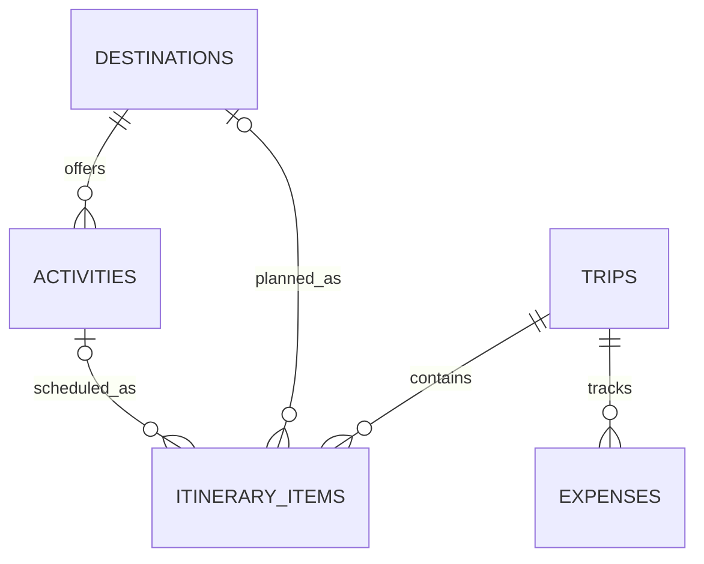

# Teleport Data Model and API Plan v0

**Status: Model direction approved for coding.** The SQL schema and EF Core mapping have been written, but the schema has not been applied to a running PostgreSQL server. Destination, activity, trip, itinerary, and expense routes are implemented in API source but have not been verified against a database.

## Scope Assumptions to Confirm

- **Confirmed:** The first database prototype has no sign-in or account ownership because registration and authentication are not in the current core user stories.
- Trip start and end dates are optional; when both exist, the end date cannot precede the start date.
- Expense currency is not yet specified. This model stores a positive numeric amount only; it does not convert currencies.
- Destination and activity records will be real, reviewed project data before they are used as evidence. No seed data is defined here.

## Proposed Relational Model

| Table | Proposed fields | Purpose |
| --- | --- | --- |
| `destinations` | `id` PK, `name`, `region`, `category`, `description`, `image_url` | Browse, search, filter, and display destination details. |
| `activities` | `id` PK, `destination_id` FK, `name`, `description` | Store activities associated with a destination. |
| `trips` | `id` PK, `name`, `start_date`, `end_date` | Create and review a basic trip. Dates and validation rules need review. |
| `itinerary_items` | `id` PK, `trip_id` FK, nullable `destination_id` FK, nullable `activity_id` FK, `sort_order` | Organize destinations or activities within a trip. A check constraint should require exactly one of destination/activity per item. |
| `expenses` | `id` PK, `trip_id` FK, `description`, `amount` | Record basic expenses for a trip. Amount must be positive. Currency is undecided. |

This draft has five related tables. It intentionally does not add users, categories, or other entities without a supporting requirement.

## Data-Access Choice

EF Core with the Npgsql provider was selected for this relational CRUD prototype. EF Core maps the five related entities and can manage schema migrations; direct Npgsql SQL would keep each query explicit but require manual query and row mapping. No performance comparison has been run, so this is a provisional learning-oriented choice rather than a measured result.

## Initial API Resource Plan

The API is the only application layer that accesses PostgreSQL. All routes below have implementation code; database responses await a running PostgreSQL instance.

| Method and route | Purpose | Status |
| --- | --- | --- |
| `GET /api/destinations` | Browse, search, and filter destinations. | Implemented in source; database response unverified. |
| `GET /api/destinations/{id}` | View destination details. | Implemented in source; database response unverified. |
| `GET /api/destinations/{id}/activities` | View activities for a destination. | Implemented in source; database response unverified. |
| `GET /api/trips` | List trips. | Implemented in source; database response unverified. |
| `POST /api/trips` | Create a trip. | Implemented in source; database response unverified. |
| `GET /api/trips/{id}` | View basic trip details. | Implemented in source; database response unverified. |
| `PUT /api/trips/{id}` | Update a trip. | Implemented in source; database response unverified. |
| `DELETE /api/trips/{id}` | Delete a trip. | Implemented in source; database response unverified. |
| `GET /api/trips/{tripId}/itinerary-items` | List a trip's itinerary. | Implemented in source; database response unverified. |
| `POST /api/trips/{tripId}/itinerary-items` | Add a destination or activity to a trip. | Implemented in source; database response unverified. |
| `PUT /api/trips/{tripId}/itinerary-items/{id}` | Change itinerary order. | Implemented in source; database response unverified. |
| `DELETE /api/trips/{tripId}/itinerary-items/{id}` | Remove an itinerary item. | Implemented in source; database response unverified. |
| `GET /api/trips/{tripId}/expenses` | List expenses for a trip. | Implemented in source; database response unverified. |
| `GET /api/trips/{tripId}/expenses/{id}` | View one trip expense. | Implemented in source; database response unverified. |
| `POST /api/trips/{tripId}/expenses` | Add an expense to a trip. | Implemented in source; database response unverified. |
| `PUT /api/trips/{tripId}/expenses/{id}` | Update an expense. | Implemented in source; database response unverified. |
| `DELETE /api/trips/{tripId}/expenses/{id}` | Delete an expense. | Implemented in source; database response unverified. |

## Implementation Order

1. Start PostgreSQL in the planned database/container stage and apply the schema or EF Core migration.
2. Add reviewed destination data; no data is seeded by the current schema file.
3. Verify the implemented resource routes against PostgreSQL through OpenAPI/HTTP requests.
4. Add reviewed destination data; no data is seeded by the current schema file.
5. Build the Angular trip, itinerary, and expense workflows.
6. Verify the Angular views against successful database-backed API responses.

The Angular destination view now requests `GET /api/destinations` and has loading, empty, and error states. The current `/api/health` endpoint only checks that the API host is running; it does not prove database connectivity or destination data access. The local PostgreSQL server was not installed because Homebrew required a source build and unrelated dependency upgrades; the database runtime is deferred to the Podman stage.
