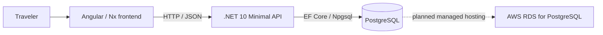
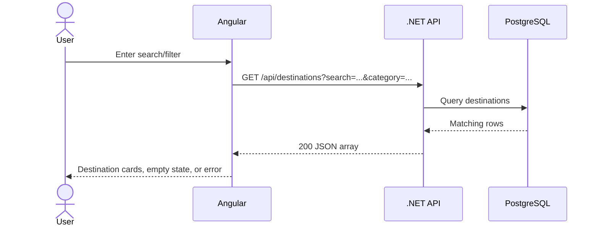
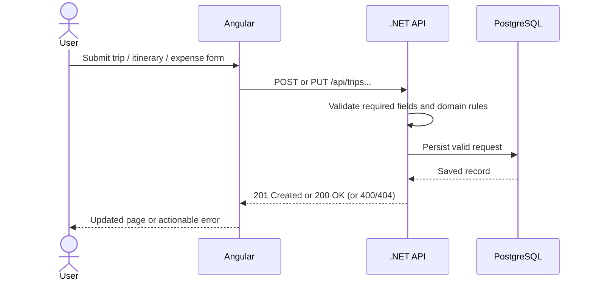
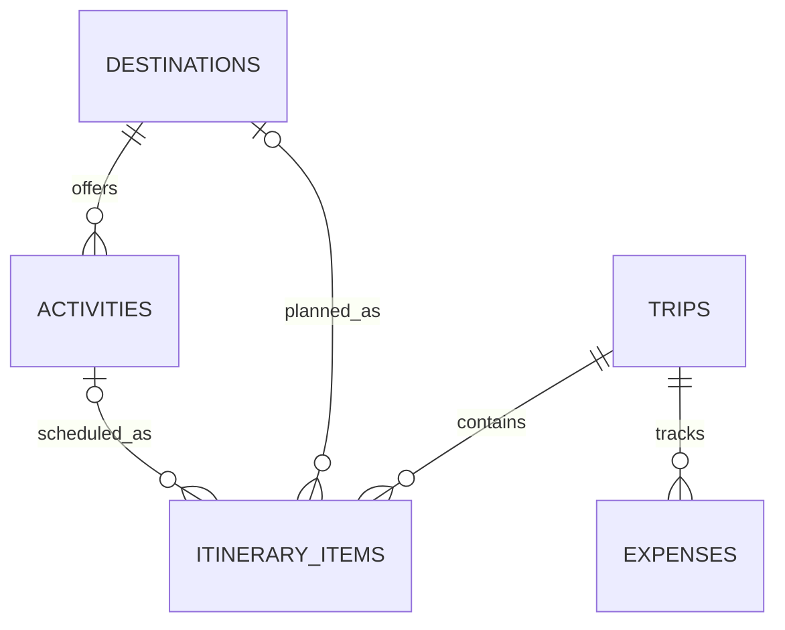

# Teleport Data Model, API, and Data Flow

**Project type:** Proof of Concept
**Status:** The API, relational schema, Angular trip workflows, and local data flows are implemented and verified. PostgreSQL 18.1 is reachable locally, with the five-table schema and reviewed demo data. The web/API/PostgreSQL Compose stack also built and ran successfully with Docker Desktop. Podman-specific runtime use and AWS hosting have not been verified.

## Architecture

The browser communicates only with the API. During local development, the API uses PostgreSQL on the developer machine. The selected project direction is Podman-compatible local containerization and AWS-hosted PostgreSQL later. Cloud resources are not part of local verification.

## Primary Data Flows

### Destination discovery

### Trip, itinerary, and expense planning

## Data Collection

| Entity | Fields | Required / validation |
| --- | --- | --- |
| Destination | Name, region, category, description, optional image URL | Curated project data; name and region are nonblank. |
| Activity | Destination, name, description | Curated project data; destination and name are required. |
| Trip | Name, optional start date, optional end date | Name required; if both dates exist, end date must not precede start date. |
| Itinerary item | Trip, exactly one of destination or activity, sort order | Order must be non-negative. A trip and selected destination/activity must exist. |
| Expense | Trip, description, positive amount, optional date | Description required; amount greater than zero; omitted date defaults to current date. |

Account ownership and sign-in are excluded from this initial prototype. The web UI currently displays amounts as USD; multi-currency conversion is not supported.

## Relational Model

| Table | Key fields | Constraints / relationships |
| --- | --- | --- |
| `destinations` | `id` PK, `name`, `region`, `category`, `description`, `image_url` | Unique name/region; name and region nonblank. |
| `activities` | `id` PK, `destination_id` FK, `name`, `description` | Destination deletion cascades; unique destination/name. |
| `trips` | `id` PK, `name`, `start_date`, `end_date`, `created_at` | Name nonblank; date range ordered. |
| `itinerary_items` | `id` PK, `trip_id` FK, nullable `destination_id` FK, nullable `activity_id` FK, `sort_order` | Exactly one of destination/activity; non-negative order; trip deletion cascades. |
| `expenses` | `id` PK, `trip_id` FK, `description`, `amount`, `expense_date` | Positive amount; nonblank description; trip deletion cascades. |

The SQL definition is in `database/schema/001_initial.sql`; the EF Core mapping is in `apps/api/Data/TeleportDbContext.cs`. EF Core/Npgsql is the selected learning-oriented data-access approach; no performance comparison has been run.

## API Contract and Implementation

All listed resource endpoints are implemented in `apps/api/Endpoints`. API responses that access data require PostgreSQL. Invalid business input returns an ASP.NET validation problem response.

| Method and route | Purpose / input | Success | Validation / other responses |
| --- | --- | --- | --- |
| `GET /api/health` | Host liveness | `200` | Does not check database connectivity. |
| `GET /api/destinations?search=&category=` | Browse, search, filter | `200` array | Empty array when no matches. |
| `GET /api/destinations/{id}` | Destination detail | `200` | `404` if absent. |
| `GET /api/destinations/{destinationId}/activities` | List activities | `200` array | `404` if destination absent. |
| `GET /api/trips` | List trips | `200` array | — |
| `GET /api/trips/{id}` | Trip detail | `200` | `404` if absent. |
| `POST /api/trips` | `{ name, startDate?, endDate? }` | `201` | `400` for blank name or invalid date order. |
| `PUT /api/trips/{id}` | Replace trip name/date range | `200` | `400` invalid input; `404` if absent. |
| `DELETE /api/trips/{id}` | Delete trip and dependent itinerary/expense rows | `204` | `404` if absent. |
| `GET /api/trips/{tripId}/itinerary-items` | List ordered itinerary | `200` array | `404` if trip absent. |
| `POST /api/trips/{tripId}/itinerary-items` | `{ destinationId?, activityId?, sortOrder }` | `201` | Exactly one subject and non-negative order; `404` if referenced trip/destination/activity is absent. |
| `PUT /api/trips/{tripId}/itinerary-items/{id}` | `{ sortOrder }` | `200` | Non-negative order; `404` if item absent. |
| `DELETE /api/trips/{tripId}/itinerary-items/{id}` | Remove itinerary item | `204` | `404` if absent. |
| `GET /api/trips/{tripId}/expenses` | List trip expenses | `200` array | `404` if trip absent. |
| `GET /api/trips/{tripId}/expenses/{id}` | Expense detail | `200` | `404` if absent. |
| `POST /api/trips/{tripId}/expenses` | `{ description, amount, expenseDate? }` | `201` | Description nonblank and amount positive; `404` if trip absent. |
| `PUT /api/trips/{tripId}/expenses/{id}` | Replace description, amount, date | `200` | Same validation; `404` if expense absent. |
| `DELETE /api/trips/{tripId}/expenses/{id}` | Delete expense | `204` | `404` if absent. |

The OpenAPI document is available at `/openapi/v1.json` when the API runs in Development. The request examples are in `apps/api/Teleport.Api.http`.

## Data Preparation and Verification

Destination records are curated project data, not production or live travel information. Source links, raw research notes, normalized CSVs, and the idempotent PostgreSQL seed script are maintained under `data/` and `database/seed/`.

The local PostgreSQL server was observed as version 18.1, with all five expected public tables. The idempotent demo seed added two destinations and five activities. Counts after API smoke and browser tests: 2 destinations, 5 activities, 1 pre-existing trip, 0 itinerary items, and 0 expenses. Tests created and removed only uniquely named trips and their associated child records; the pre-existing trip was left unchanged.

`scripts/smoke-test-api.sh` verified database-backed destination, search, and activity reads; invalid-input handling; trip create/read/delete; itinerary add/list/reorder/delete; and expense create/list/update/delete. Browser verification exercised trip creation, itinerary add/reorder/remove, and expense add/edit/delete. The development health endpoint is host liveness, not a database readiness check.

The same smoke test passed against the Compose PostgreSQL and API containers. Nginx served the Angular page and proxied `/api` requests successfully; the homepage displayed the two seeded destinations. The container database remains separate from the local `teleport_dev` database.

## Cloud and Evidence Status

- **Selected direction:** Existing project brief—Podman-compatible local containers, then AWS-hosted PostgreSQL. The course's Azure Blob/ADLS and AWS-to-Azure migration checklist is not treated as applicable because this is a POC, not a migration project.
- **Verified with Docker Desktop:** Compose built and started the API, web, and PostgreSQL services; the PostgreSQL health check passed; the web container served the app; and the containerized API/database smoke test passed. Podman itself is not installed, so Podman execution remains unverified.
- **Not done:** AWS RDS creation, network/security configuration, cost review, and API connection. No cloud resources or credentials are included in this repository.
- **Course evidence:** Trello state and Omnivox submissions must be updated by the project owner. This repository contains the evidence artifacts that can be prepared and locally verified.
