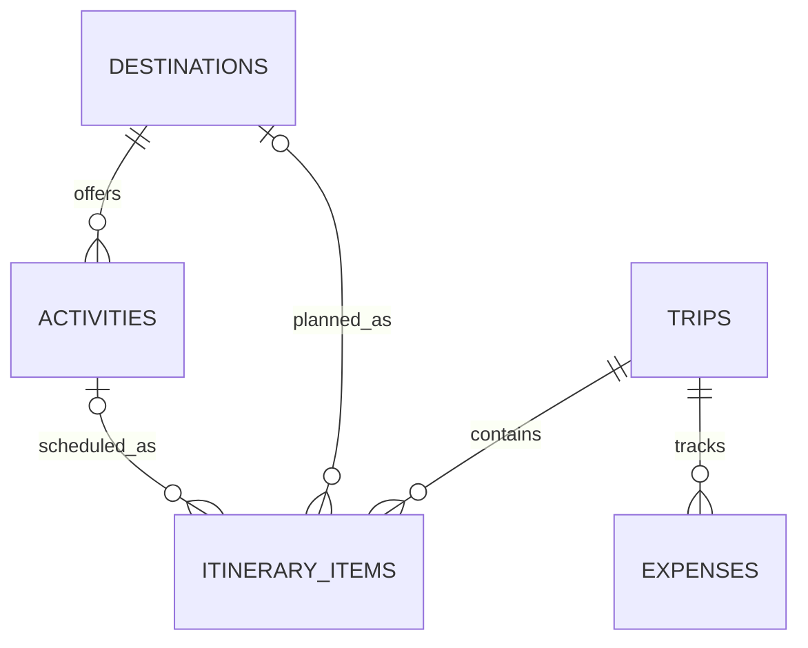

# Teleport Data Model and API Plan v0

**Status: Draft for review.** This is a proposed minimum model based on the current project scope, not an implemented schema or API contract.

## Scope Assumptions to Confirm

- **Confirmed:** The first database prototype has no sign-in or account ownership because registration and authentication are not in the current core user stories.
- Expense currency and exact trip date rules are not yet specified; do not add currency conversion or date business rules in this iteration.
- Destination and activity records will be real, reviewed project data before they are used as evidence. No seed data is defined here.

## Proposed Relational Model

| Table | Proposed fields | Purpose |
| --- | --- | --- |
| `destinations` | `id` PK, `name`, `region`, `category`, `description`, `image_url` | Browse, search, filter, and display destination details. |
| `activities` | `id` PK, `destination_id` FK, `name`, `description` | Store activities associated with a destination. |
| `trips` | `id` PK, `name`, `start_date`, `end_date` | Create and review a basic trip. Dates and validation rules need review. |
| `itinerary_items` | `id` PK, `trip_id` FK, nullable `destination_id` FK, nullable `activity_id` FK, `sort_order` | Organize destinations or activities within a trip. A check constraint should require exactly one of destination/activity per item. |
| `expenses` | `id` PK, `trip_id` FK, `description`, `amount` | Record basic expenses for a trip. Amount must be positive. Currency is undecided. |

This draft has five related tables. It intentionally does not add users, categories, or other entities without a supporting requirement.

## Initial API Resource Plan

The routes below are proposals for review, not implemented endpoints. The API will be the only application layer that accesses PostgreSQL.

| Method and route | Purpose |
| --- | --- |
| `GET /api/destinations` | Browse, search, and filter destinations. |
| `GET /api/destinations/{id}` | View destination details. |
| `GET /api/destinations/{id}/activities` | View activities for a destination. |
| `GET /api/trips` | List trips. |
| `POST /api/trips` | Create a trip. |
| `GET /api/trips/{id}` | View a trip and its itinerary. |
| `PUT /api/trips/{id}` | Update a trip. |
| `DELETE /api/trips/{id}` | Delete a trip. |
| `GET /api/trips/{tripId}/expenses` | List expenses for a trip. |
| `POST /api/trips/{tripId}/expenses` | Add an expense to a trip. |

## Implementation Order

1. Review this proposed model and resolve the open assumptions.
2. Create the PostgreSQL schema and reviewed seed data.
3. Implement the first database-backed destination GET endpoint and verify it through OpenAPI/HTTP requests.
4. Add trip, itinerary, and expense operations incrementally.
5. Connect the Angular destination view to the API.

The current `/api/health` endpoint only checks that the API host is running; it does not prove database connectivity or destination data access.
