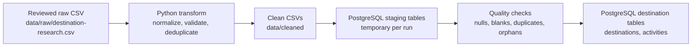

# Teleport Data Pipeline v0

**Purpose:** Week 6 proof of concept for moving reviewed destination research through validation and normalization into PostgreSQL. This is a small batch ETL pipeline, not a live travel feed.

## Design

## Source and Destination Connections

- **Source:** local `data/raw/destination-research.csv`, with source URLs for the reviewed facts. The source is summarized in `data/README.md`.
- **Transform:** `scripts/transform_destination_research.py` uses Python's CSV library, Unicode NFC normalization, whitespace cleanup, duplicate detection, required-field checks, and activity-to-destination reference checks.
- **Destination:** PostgreSQL connection settings are supplied through `PGHOST`, `PGPORT`, `PGDATABASE`, and `PGUSER`. The script does not store credentials. The verified run used a separate local `teleport_etl_demo` database, not the application's `teleport_dev` database.
- **Load:** `scripts/load_destination_data.sql` copies cleaned files into temporary staging tables, reports quality counts, aborts on invalid rows, and inserts with conflict-safe keys.
- **Run:** `scripts/run_destination_etl.sh` applies the idempotent schema, transforms the raw file into `data/cleaned`, then runs the PostgreSQL loader.

## Verified Run Result

On 2026-10-25, the pipeline ran successfully against the isolated local `teleport_etl_demo` database:

| Check/result | Observed |
| --- | ---: |
| Raw source records | 7 |
| Clean destination rows | 2 |
| Clean activity rows | 5 |
| Duplicate records removed | 0 |
| Blank/null required-field violations | 0 |
| Duplicate natural keys | 0 |
| Activities without a staged destination | 0 |
| Rows inserted on first successful load | 2 destinations, 5 activities |
| Rows inserted on repeat load | 0 destinations, 0 activities |
| Final destination/activity row counts | 2 / 5 |

The transform output was compared as parsed CSV records with the existing reviewed cleaned files; both datasets matched. CSV quoting may differ while parsed values remain the same.

## Latest Verification

On 2026-11-02, the transform was rerun to a temporary output directory so the existing reviewed CSV formatting was preserved. The parsed transformed rows matched both tracked cleaned CSVs. The SQL loader then loaded those temporary outputs into `teleport_etl_demo`: 2 destination rows and 5 activity rows passed all staging checks, and the idempotent insert added 0 rows because the target already contained the same data. The final target counts remained 2 / 5.

## Week 6 Evidence Map

| Assignment evidence | Project evidence | Screenshot to capture |
| --- | --- | --- |
| Trello progress | The owner's `Travel Website – PoC` board | Owner captures the Week 6 card and its current status; the assistant does not access or modify the board. |
| Pipeline design | This document's flow diagram and design notes | Capture the diagram and source/destination sections. |
| Source/destination connections | `data/raw/destination-research.csv`, `scripts/run_destination_etl.sh`, and the documented `PG*` settings | Capture the command and database name, with no passwords or tokens visible. |
| Successful run | The transform summary and staging/load results above | Capture the real terminal output from the transform and load; do not fabricate or edit results. |
| Transformed/moved data | `data/cleaned/*.csv` and the 2 / 5 counts in `teleport_etl_demo` | Capture the cleaned rows and read-only database counts. |
| Updated architecture | `docs/analytics-architecture-v0.md` and this pipeline diagram | Capture the architecture and ETL flow diagrams. |
| GitHub progress | The commit containing these pipeline artifacts | Capture the pushed commit after it is available on GitHub. |

## Issue and Fix

The first run against a new empty database stopped because its destination tables did not exist. The runner was updated to apply `database/schema/001_initial.sql` before loading. A second run succeeded. Repeating the run inserted zero duplicate rows, confirming the conflict-safe load behavior.

## Scope and Limitations

- The dataset contains only two reviewed destinations and five associated activities; it is enough to test the pipeline, not to support broad business conclusions.
- No fake customer, trip, or expense records were added.
- This pipeline currently loads local files into PostgreSQL. `scripts/upload-data-to-azure.sh` prepares the `data/` tree for an existing Azure Blob container, but the upload has not been run. Azure CLI, an authenticated account, and an approved target are required. No AWS or Azure resources are created by the ETL pipeline.
- The isolated `teleport_etl_demo` database is a local demonstration target; the application uses its separate `teleport_dev` database.
